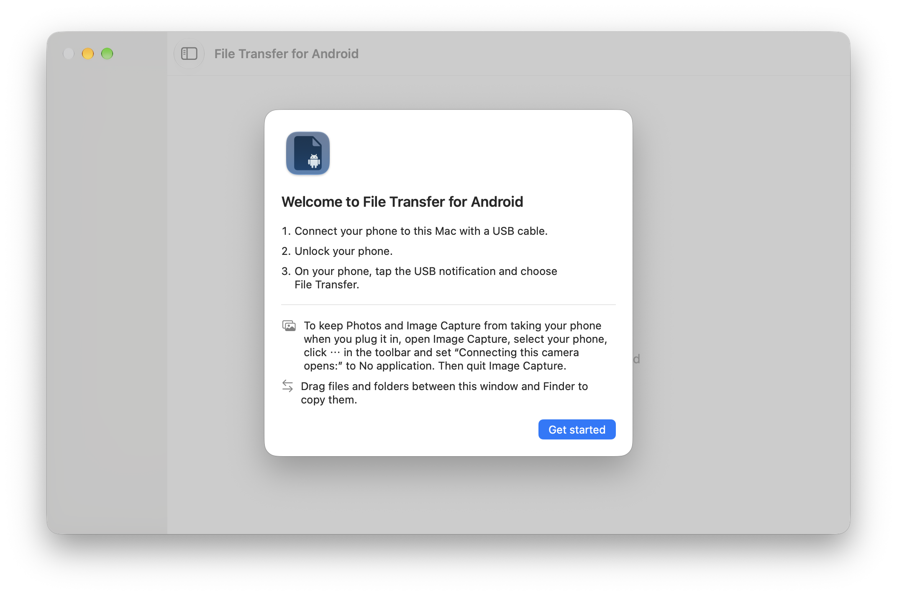
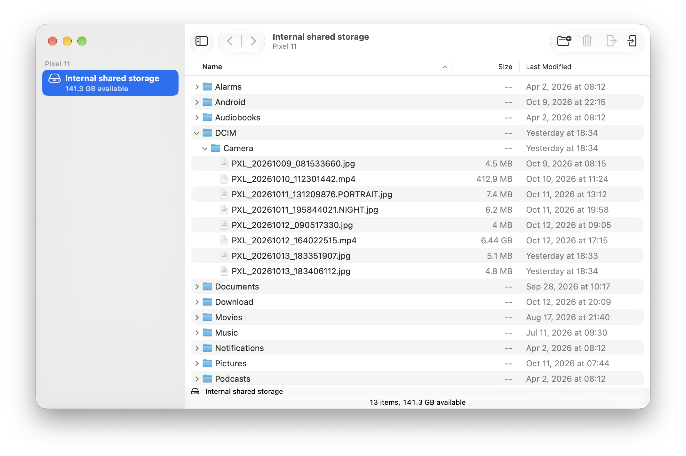

# File Transfer for Android

File Transfer for Android is a free, open-source Mac app for copying files between a Mac and an Android phone over USB. It works entirely offline: the app never connects to the internet, so your files travel only over the USB cable between your phone and your Mac. There are no ads, no accounts and no tracking. It shows the phone's files in a window and copies files and folders in both directions, including files larger than 4 GB.

This is an unofficial app. It is not affiliated with Google, and Android is a trademark of Google LLC.

## Requirements

- A Mac with Apple silicon
- macOS 27 or later
- A USB cable that carries data, not just power

## Install

1. Download the DMG from the [Releases page](https://github.com/Lin-Xavier/File-Transfer-for-Android/releases).
2. Open the DMG and drag File Transfer for Android onto the Applications folder.
3. Open the app from Applications.

## Connecting

The app shows these steps when no phone is connected:

1. Connect your phone to this Mac with a USB cable.
2. Unlock your phone.
3. On your phone, tap the USB notification and choose File Transfer.

The phone's storage appears in the sidebar. To copy, drag files and folders between the window and Finder, or select items and use Download to Mac or Upload to Android in the File menu or the toolbar. The File menu also has New Folder, Rename, Delete and Quick Look.

## Stop Photos and Image Capture from taking the phone

When you plug in a phone, macOS can open Photos or Image Capture, and while either one has the phone, this app can't reach it. The app's welcome screen has this tip:

> To keep Photos and Image Capture from taking your phone when you plug it in, open Image Capture, select your phone, click ⋯ in the toolbar and set “Connecting this camera opens:” to No application. Then quit Image Capture.

## Troubleshooting

### "Your phone is in use"

Another app has the phone. Usually it's the macOS camera service, which Photos, Image Capture and Preview use. Quit that app and your phone connects on its own; the camera service can take about ten seconds to let go. If the message names a different app, quit that one. Apps such as OpenMTP or Smart Switch also hold the phone while they run.

### "Can't access device storage"

The phone is locked. Unlock it and choose File Transfer. The app connects on its own once the phone is unlocked.

### "No Android device found"

Check that the phone is in File Transfer mode. Many phones start a USB connection in charging mode only, so tap the USB notification on the phone and choose File Transfer.

If that doesn't help, check the cable and the port. Some USB cables only charge. Use a cable that carries data, and plug it straight into the Mac rather than through a hub.

### "Can't connect to your phone" or "Lost contact with your phone"

Reconnect the phone or restart it, then click Retry.

## Known limitations

- SD cards haven't been tested.
- The app runs only on macOS 27 or later, on a Mac with Apple silicon.
- Messages won't accept files dragged from the app unless they are content such as photos. Files like .zip or .apk are refused. Use Download to Mac first, then drag the file from Finder.
- If you drag several messages from Mail onto the app, it copies them but also reports items that couldn't be copied. Nothing is lost.
- If the phone and the Mac use different time zones, file dates can be off by the difference until you first create a folder or upload a file with the app.
- The ⌘? shortcut opens the system's Help search instead of this page. Use Help > File Transfer for Android Help.

## License

File Transfer for Android is free software: you can redistribute it and/or modify it under the terms of the GNU General Public License as published by the Free Software Foundation, either version 3 of the License, or (at your option) any later version. See [LICENSE](LICENSE).

The app bundles no third-party code.

The Android robot in the app icon is reproduced or modified from work created and shared by Google and used according to terms described in the Creative Commons 3.0 Attribution License.
